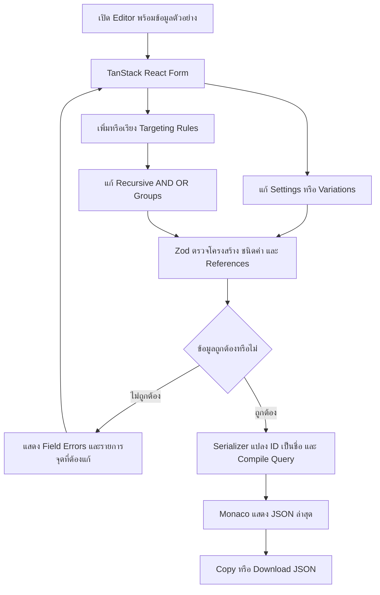
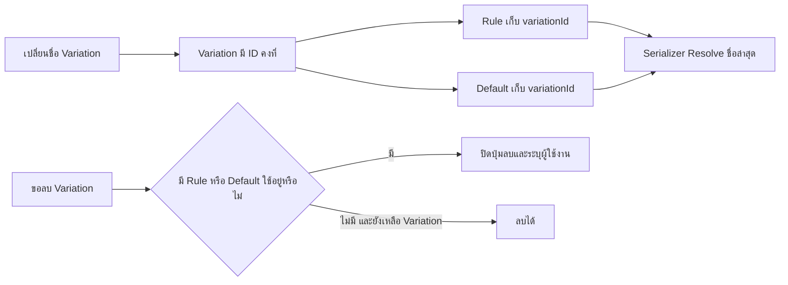

# SWD Feature Flag Editor

## เริ่มใช้งาน

```sh
npm install
npm run dev
```

เปิด `http://localhost:3000/code-challenge/feature-flag-form`

```sh
npx tsc --noEmit
npm test
npm run build
```

## ขอบเขต

- Flag key, description, enabled/disabled และ track events
- Variations ชนิด boolean, string, number, JSON; เพิ่ม/ลบและเปลี่ยนชื่อ
- Targeting rules แบบ array; เพิ่ม/ลบและเลื่อนลำดับด้วยปุ่มที่ใช้งานผ่าน keyboard ได้
- กลุ่ม AND/OR ซ้อนกันแบบ recursive; เปรียบเทียบ attribute ด้วย eq/ne/gt/lt
- Groups/Roles เป็น evaluation-context attributes (`group`, `role`) ไม่ใช่ระบบจัดการบัญชีหรือ RBAC
- Default variation, live JSON ผ่าน Monaco, Copy และ Download เมื่อ configuration ถูกต้อง
- ไม่เชื่อม Backend; ข้อมูลอยู่ในหน่วยความจำ รีเฟรชหน้าแล้วกลับเป็นตัวอย่างเริ่มต้น

## Flow การแก้ไข



`form.Field` ผูก input กับ form state โดยตรง ไม่มีสำเนา state ของฟอร์มใน React state ส่วน `form.Subscribe` เลือกติดตามเฉพาะข้อมูลที่ต้องใช้ เช่น รายการ Variations และ Preview การแก้เงื่อนไขจะอัปเดต field ของ group โดยตรง ต้นไม้ recursive ถูกมองเป็น atomic field ที่ขอบเขต TanStack เพื่อหลีกเลี่ยงการขยาย DeepKeys แบบไม่สิ้นสุดใน TypeScript และใช้ Zod ตรวจทุก node ก่อนสร้าง Output

## Flow การอ้างอิง Variation



เปลี่ยนชื่อได้โดยไม่ทำให้ Reference เสีย การลบต้องย้าย Rule/Default ไปตัวเลือกอื่นก่อน และต้องเหลืออย่างน้อยหนึ่ง Variation

## Validation และ Output Contract

ตรวจความถูกต้องทุกครั้งที่ค่าเปลี่ยนเพื่อควบคุม Preview และ Export โดยแสดงข้อความรายฟิลด์หลังหยุดพิมพ์ 600 มิลลิวินาที หรือทันทีหลัง blur ส่วนเงื่อนไข recursive จดจำฟิลด์ที่ blur ด้วย ID ของแต่ละ node เพื่อให้การเพิ่มเงื่อนไขใหม่ไม่แสดง error ทันที

- Zod ตรวจ flag/variation keys ที่ไม่ว่าง ไม่มี whitespace และไม่มีชื่อ Variation ซ้ำ
- ตรวจค่าตามชนิด รวม finite numbers และ JSON ที่ไม่มีเลข infinity
- ตรวจเงื่อนไข recursive ทุกชั้น กลุ่มต้องไม่ว่าง; gt/lt ใช้กับ number เท่านั้น
- ตรวจ Rule name, Percentage 0–100 รวมค่าทศนิยม และ Variation references ที่ยังมีจริง
- เปลี่ยนชนิดข้อมูลแล้วคงค่าดิบไว้เพื่อให้ผู้ใช้แก้เอง ไม่แปลงความหมายเงียบ ๆ
- ระหว่างกรอกข้อมูลไม่ครบ Preview แสดง configuration ล่าสุดที่ถูกต้อง พร้อมป้าย Last valid configuration และชื่อฟิลด์ที่ต้องแก้แบบอ่านง่าย โดยปิด Copy/Download จนข้อมูลล่าสุดถูกต้อง หากชื่อ variation ว่าง Preview จะแสดงเฉพาะรายการที่มีชื่อเมื่อยังสร้าง configuration ที่ถูกต้องได้
- Serializer ตรวจ Zod ซ้ำที่ขอบเขตการส่งออก ไม่ส่ง UI IDs ออกไป และ escape string ใน query ด้วย JSON.stringify

ใช้ `{ "flags": { "flag-key": ... } }` และ scalar `percentage` ตาม [ตัวอย่าง JSON ของโจทย์](./docs/example-flag.json) นี่เป็น assignment contract ซึ่งต่างจาก native GO Feature Flag ที่ไม่มี wrapper `flags` และใช้ percentage map เมื่อทำ rollout จึงไม่อ้างว่าไฟล์นี้นำเข้า native GO Feature Flag ได้โดยตรง ความหมายการแบ่งทราฟฟิกเมื่อ percentage ต่ำกว่า 100 เป็นความรับผิดชอบของระบบผู้ใช้ configuration; editor นี้ไม่ได้จำลอง evaluation engine

อ้างอิง [GO Feature Flag targeting](https://gofeatureflag.org/docs/configure_flag/target-with-flags) สำหรับ query operators และการตรวจ Rule จากบนลงล่างแบบ first match wins คำอธิบาย Flag ส่งผ่าน metadata.description; เปิด/ปิดส่งเป็น disable ซึ่งกลับค่าจาก enabled

## โครงสร้าง

โค้ดอยู่ใน `src/features/feature-flag-editor/` โดยหน้าโจทย์เดิมยังเป็นทางเข้า Editor

- `FeatureFlagEditor.tsx` ประกอบหน้าจอจากฟอร์มเดียวใน `hooks/use-flag-form.ts`
- `components/` เก็บส่วนของฟอร์ม ตัวสร้างเงื่อนไขซ้อน และ JSON preview
- `model/` เก็บชนิดข้อมูล กฎ validation และการสร้าง configuration ที่ทดสอบได้โดยตรงด้วย Vitest

Monaco โหลดแบบ lazy ฝั่ง client และใช้ loader ของ @monaco-editor/react ซึ่งโหลด editor runtime จาก CDN; ระหว่างโหลดมี plain JSON fallback ใช้อ่านได้

## การตรวจสอบ

Regression tests ครอบคลุม nested query precedence, escaping, output types, rename/reference safety, rule order, invalid percentages และ empty groups รวมถึง interaction tests ของฟอร์ม
