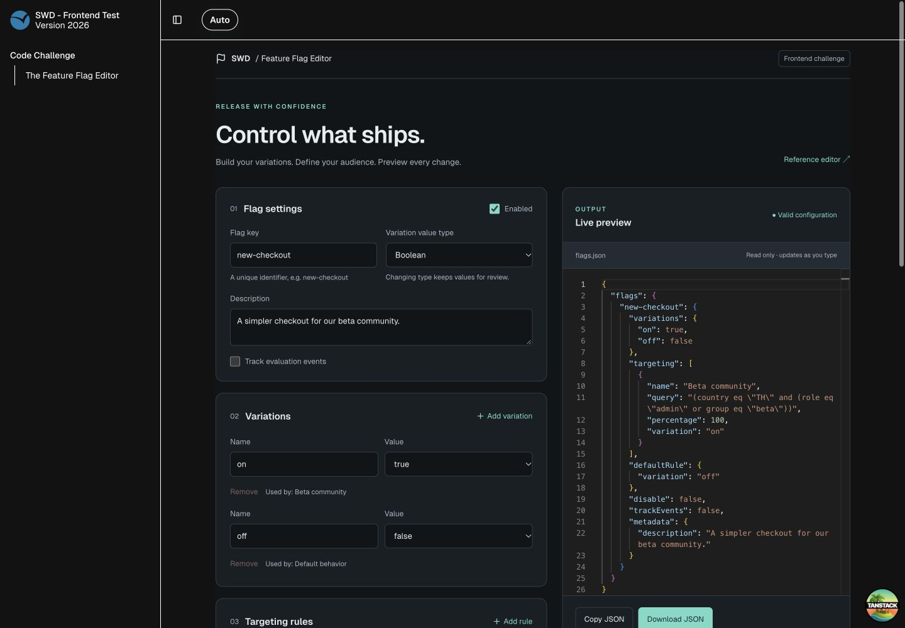

# SWD Feature Flag Editor

เว็บสร้าง Feature Flag Configuration ผ่านฟอร์ม พร้อมเงื่อนไข AND/OR ซ้อนกันและ JSON Preview แบบ real-time

## เริ่มใช้งาน

ติดตั้ง Node.js 22.13 ขึ้นไปและ npm จากนั้นรันในโฟลเดอร์โปรเจกต์

```sh
npm ci
npm run dev
```

เปิด [Feature Flag Editor](http://localhost:3000/code-challenge/feature-flag-form) หยุดเซิร์ฟเวอร์ด้วย Ctrl+C



## ฟีเจอร์

- ตั้งชื่อ คำอธิบาย สถานะเปิด/ปิด และ track events
- เพิ่ม ลบ และเปลี่ยนชื่อ Variations รองรับ Boolean, String, Number และ JSON
- สร้าง Targeting Rules ด้วยกลุ่ม AND/OR ซ้อนกัน และเลื่อนลำดับ Rule
- ใช้ attributes เช่น group, role และ country เพื่อระบุกลุ่มเป้าหมาย
- เลือก Default Variation และป้องกันการลบ Variation ที่ถูกอ้างอิงอยู่
- แสดงข้อผิดพลาดหลังหยุดพิมพ์ 600 มิลลิวินาที หรือทันทีเมื่อออกจากช่อง
- คง JSON ล่าสุดที่ถูกต้องระหว่างกรอกข้อมูล พร้อมระบุสถานะ Draft incomplete หากชื่อ variation ว่าง Preview จะแสดงเฉพาะรายการที่มีชื่อเมื่อยังสร้าง configuration ที่ถูกต้องได้
- Copy และ Download JSON เมื่อข้อมูลปัจจุบันถูกต้อง

## โครงสร้างและแนวทางออกแบบ

```text
src/
├── routes/                         ทางเข้าของแต่ละหน้า
├── components/                     UI และ layout ที่ใช้ร่วมกัน
└── features/feature-flag-editor/
    ├── FeatureFlagEditor.tsx        ประกอบหน้าจอ
    ├── components/                 ส่วนของฟอร์มและ Preview
    ├── hooks/                      TanStack React Form
    └── model/                      Types, Zod validation และ JSON transformation
```

ใช้ TanStack React Form เป็นแหล่งข้อมูลของฟอร์ม โดยแต่ละ component subscribe เฉพาะข้อมูลที่ใช้ กฎ validation และการสร้าง query อยู่ใน model เพื่อทดสอบได้โดยตรง ใช้ ID คงที่อ้างอิง Variation แล้ว resolve เป็นชื่อเมื่อส่งออก ทำให้เปลี่ยนชื่อได้โดย Rule และ Default ยังอ้างรายการเดิม

ใช้ React 19, TanStack Start/Router, Zod, Monaco Editor, Tailwind CSS และ Vitest ร่วมกับ Testing Library

## ตรวจสอบงาน

```sh
npx tsc --noEmit
npm test
npm run lint
npm run build
```

Tests ครอบคลุมชนิดข้อมูล ชื่อซ้ำ Reference การจัดกลุ่ม query การเพิ่ม/ลบและเรียงรายการ จังหวะ validation และการส่งออก JSON รวมถึงกรณี Clipboard ล้มเหลว

## Output และข้อจำกัด

JSON ใช้ wrapper `flags` และ scalar `percentage` ตาม [ตัวอย่างของโจทย์](./docs/example-flag.json) หากนำไปใช้กับ native GO Feature Flag ต้องแปลงให้ตรงสัญญาของระบบปลายทาง ซึ่งใช้ percentage map สำหรับ rollout

ข้อมูลอยู่ในหน่วยความจำของหน้า รีเฟรชแล้วกลับเป็นค่าเริ่มต้น Monaco โหลด runtime ผ่าน CDN และมี plain JSON แสดงระหว่างโหลด

อ่าน [flow diagrams และ technical decisions](./NOTES.md) และ [โจทย์ต้นฉบับ](./docs/assignment.md)
